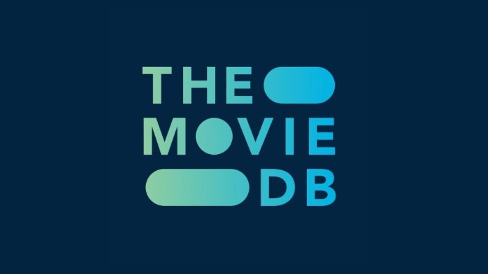
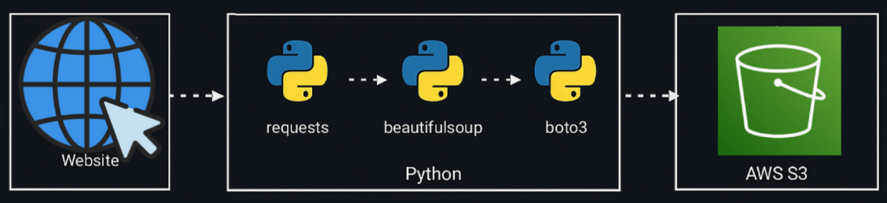

# Movie Database Web Scraper: scraping_corns
<p align="center">
   
</p>

This project demonstrates practical web scraping techniques using Python's **BeautifulSoup**. It focuses on extracting structured data from **The Movie Database (TMDB)** such as movie titles, release years etc, by navigating and parsing HTML content.<br>

After extracting the raw data, it is cleaned and transformed using **pandas** for further analysis. The processed results are then exported to a CSV file and can be uploaded to AWS S3 using **boto3** for cloud storage and further accessibility.


## Features

- Scrapes movie data across multiple pages  
- Parses HTML using `BeautifulSoup`  
- Cleans and structures data using `pandas`  
- Exports the final dataset
- Uploads the final CSV to AWS S3 using `boto3`


## Libraries Used

* `requests` – for sending HTTP requests
* `BeautifulSoup` – for parsing HTML
* `numpy` – for numerical operations
* `pandas` – for data manipulation and cleaning
* `re` – for regular expression operations
* `boto3` – for interacting with AWS S3
* `os` – for handling file paths and system operations
* `dotenv` (`load_dotenv`) – for loading environment variables
  
---
### Workflow:
<p align="center">  </p>

## How to Run

### 1. Clone the repository

```bash
git clone https://github.com/r-o-bo/scraping_corns.git
cd scraping_corns
```

### 2. Install dependencies

Recommended to use a virtual environment:

```bash
pip install -r requirements.txt
```
### 3. Configure AWS credentials

Set up your AWS credentials either via environment variables or the AWS CLI:

```bash
aws configure
```
You must create your own S3 bucket and attach S3 policies to an IAM user and retrieve your access information.

```env
AWS_ACCESS_KEY_ID=your_access_key
AWS_SECRET_ACCESS_KEY=your_secret_key
```

### 4. Run the Notebook

Launch Jupyter Notebook:

```bash
jupyter notebook PopcornPicker.ipynb
```

Follow the cells to scrape, clean, and preview the data.

##  Disclaimer

This project is for educational purposes only.
The website scraped is publicly accessible, but the collected data is not redistributed or intended for public use. Please refer to the original site’s terms of service if you plan to replicate or extend this work.

##  License

This repository is open-sourced under the MIT License.
Any data shown or referenced is excluded from licensing due to third-party restrictions.


